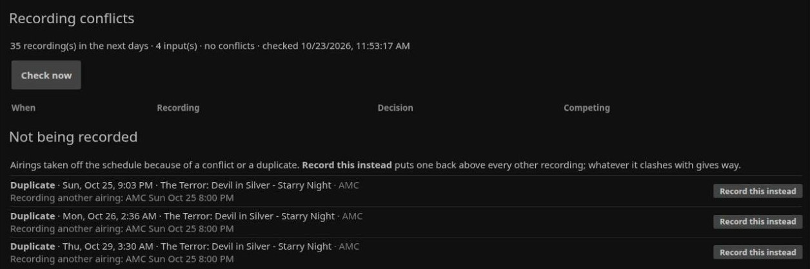
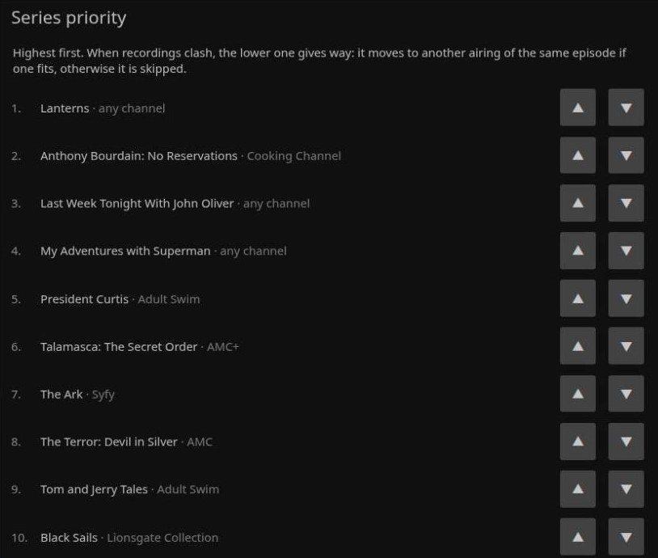
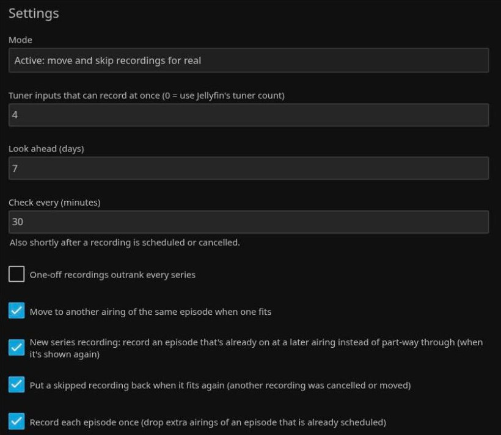
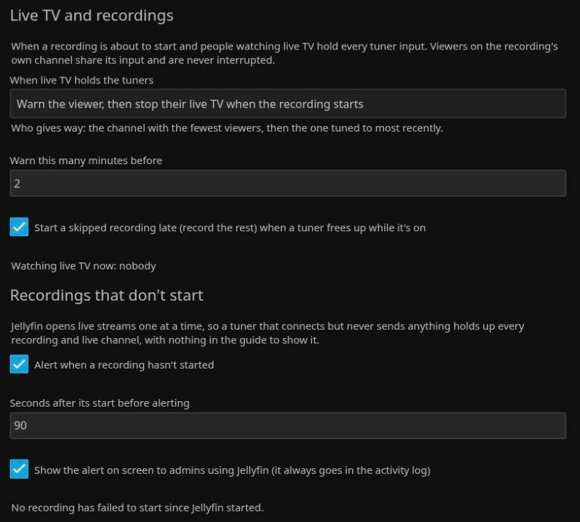

# JellyDVR Schedule (Jellyfin plugin)

SageTV-style recording priorities and conflict handling for Jellyfin 12. Jellyfin stores a priority on series
recordings but never uses it: when more recordings are scheduled than there are tuner inputs, whichever starts
last simply fails. This plugin looks ahead and resolves those conflicts by priority.

Part of the JellyDVR set alongside Comskip Commercial Segments, Episode History, JellyDVR Space, JellyDVR Live and
XMLTV Guide Cleaner.

## How it works

- **Priority:** an ordered list of your series recordings (highest first). One-off recordings (a single programme
  chosen by hand) outrank every series by default. JellyDVR Live buffers are left out: they give way on their own.
- **Conflicts:** every half hour (and 30 s after a recording is scheduled or cancelled) it looks at the next 7 days
  of recordings, padding included, for times needing more inputs than there are. Recordings on the same channel at
  the same time share one input. Recordings already running are never touched.
- **Resolving,** lowest priority first: move the recording to another airing of the same episode (same guide
  programme id) that fits, otherwise skip it. Moves create a one-off recording of the other airing; skips cancel
  the episode (series episodes are also disarmed, working around Jellyfin 12 recording cancelled episodes anyway).
- **One copy per episode** (on by default): when the same episode is scheduled more than once (e.g. a series set
  to record all airings catches every repeat), only one copy is kept — one already recording, else one scheduled
  by hand, else the earliest (or first-run) airing — and the rest are dropped. Only real episode/film guide ids
  (TMS "EP…"/"MV…") count as the same episode; show-level ids ("SH…") never do, for dropping or for moves.
- **Preview mode** (default) only shows the conflicts and what would be done.

## Settings (Dashboard → Plugins → JellyDVR Schedule)

- **Mode** — Preview (default) or Active.
- **Tuner inputs that can record at once** — 0 uses Jellyfin's tuner count.
- **Look ahead** (days, default 7) and **Check every** (minutes, default 30).
- **One-off recordings outrank every series** (on).
- **Move to another airing of the same episode when one fits** (on).
- **Series priority** — reorder with ▲ ▼.

## Screenshots

From a real server (Jellyfin 12.2). Dashboard → Plugins → JellyDVR Schedule: conflicts, and airings taken off
the schedule (here duplicates of an episode already recorded at another airing), each with **Record this
instead**:



Series priority:



Settings:



What happens when live TV holds every tuner a recording needs, and the alert for recordings that don't start:



## Install

### From the JellyDVR plugin repository (no build needed)

1. Dashboard → Plugins → **Repositories** → add (one list for all the JellyDVR plugins):
   ```
   https://raw.githubusercontent.com/mackandall/jdvr-client/main/plugins/manifest.json
   ```
2. Dashboard → Plugins → **Catalog** → **JellyDVR Schedule** → Install, then restart Jellyfin.

### Or build from source

```
dotnet build -c Release
sudo ./install.sh   # restarts Jellyfin
```

## License

GPL-2.0-or-later: you can redistribute and change it under the terms of the GNU General Public
License, version 2 or (at your option) any later version. See [LICENSE](LICENSE).

The official source and releases are at <https://github.com/mackandall/jellyfin-plugin-jellydvr-schedule>.
